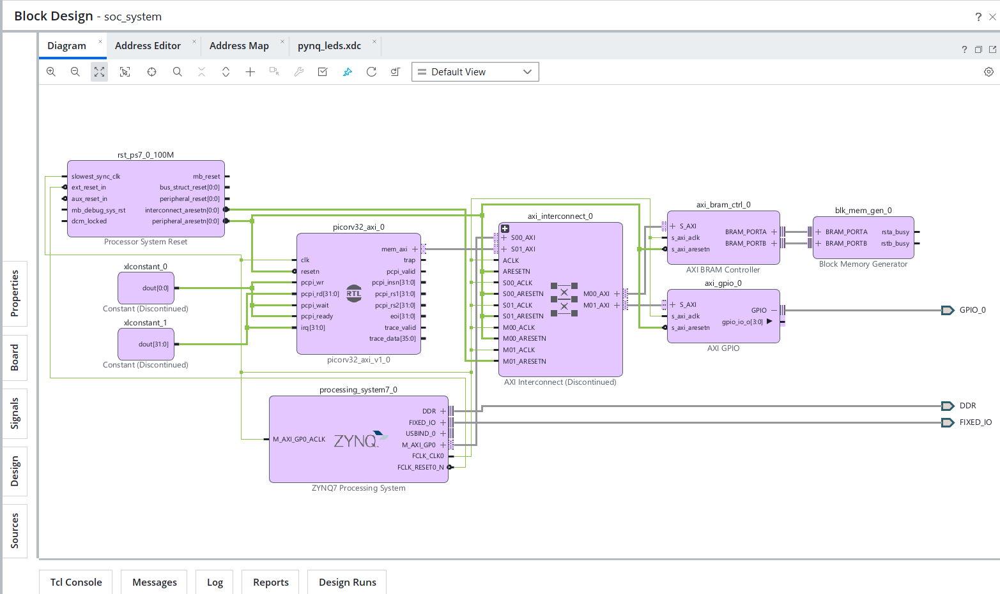
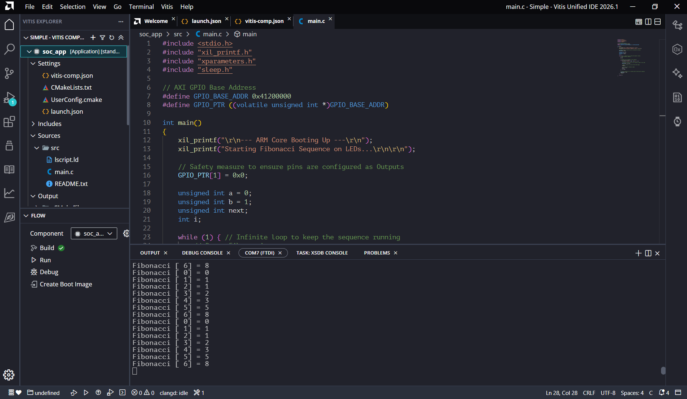
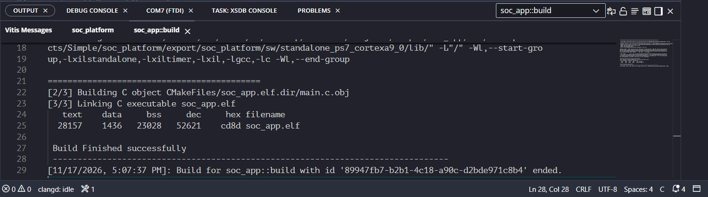
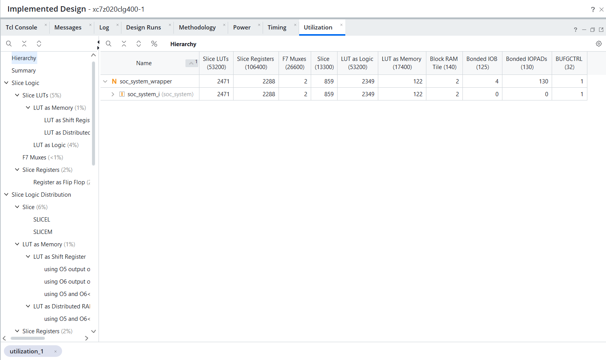
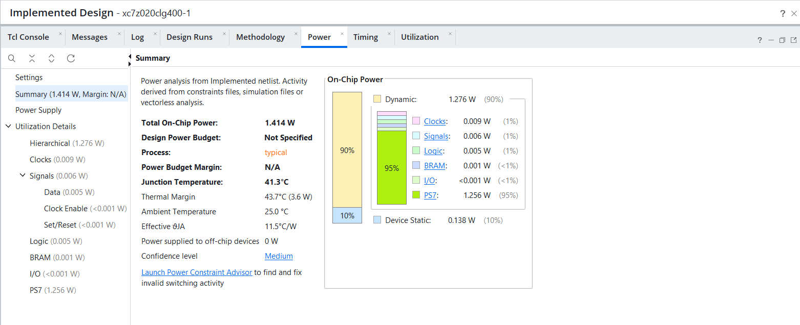
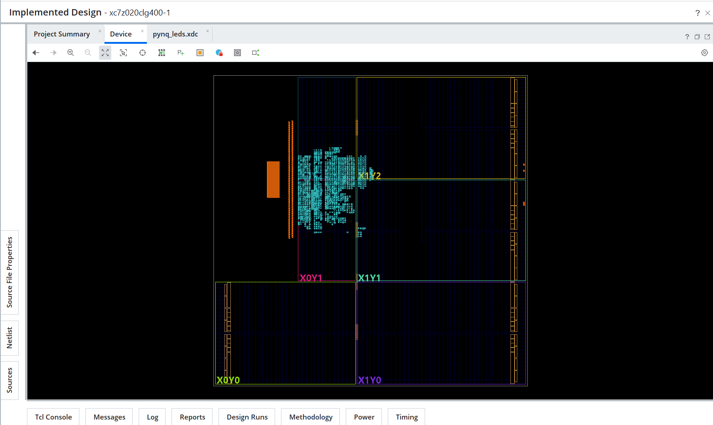
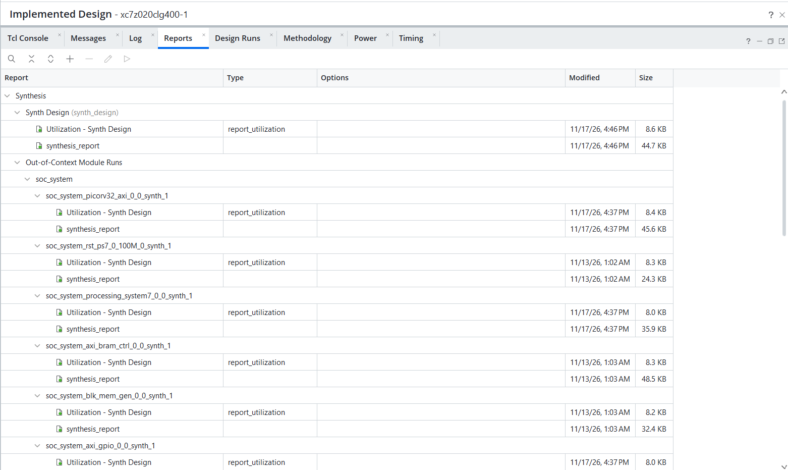
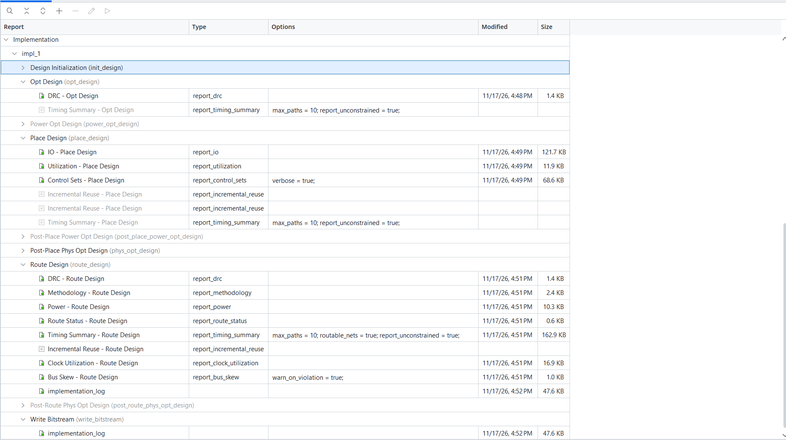

# Custom RISC-V System-on-Chip (SoC) on PYNQ-Z2

## 📖 Project Overview
This project implements a custom System-on-Chip (SoC) on a Xilinx Zynq-7000 FPGA (PYNQ-Z2). It integrates a **PicoRV32 RISC-V core** alongside the Zynq ARM Cortex-A9 processor. The ARM processor acts as the host, communicating with the RISC-V core, shared memory, and custom peripherals via an AXI4-Lite interconnect.

The system demonstrates full hardware-software co-design. A bare-metal C application running on the ARM processor calculates the Fibonacci sequence, outputs the lower 4 bits to a custom AXI GPIO peripheral connected to the onboard LEDs, and simultaneously prints the 32-bit binary representation to a serial terminal.

## 🎬 Hardware Demo
*(Upload your video as a GIF named `demo.gif` in the images folder to make this play!)*

*The video above shows the 4 onboard LEDs counting in binary as the ARM processor calculates the Fibonacci sequence.*

## 🏗️ Hardware Architecture

*   **Zynq-7000 ARM Cortex-A9**: Acts as the system host, UART controller, and memory manager.
*   **PicoRV32 Core**: 32-bit RISC-V CPU configured as an AXI4-Lite Master.
*   **AXI Interconnect**: Routes traffic between the ARM, RISC-V core, BRAM, and GPIO.
*   **Block RAM (8KB)**: Shared memory space between the ARM and RISC-V cores (Mapped at `0x40000000`).
*   **AXI GPIO**: Configured as an output to drive the 4 onboard LEDs (Mapped at `0x41200000`).

## 💻 Software Implementation
The software is written in bare-metal C using the Vitis Unified IDE. It runs on the ARM Cortex-A9 (`ps7_cortexa9_0`) and uses memory-mapped I/O to talk to the FPGA fabric. 

### Terminal Output & Code

### Build Success

## 📊 Hardware Verification & Performance

### Resource Utilization
The custom RISC-V SoC is highly efficient, utilizing less than 5% of the available logic on the Zynq-7020 FPGA.

### Timing Closure
The design successfully achieves timing closure at 100 MHz with a positive Worst Negative Slack (WNS) of 0.951 ns. All setup and hold constraints are met.

### Power Analysis
Total on-chip power consumption is approximately 1.414 W.

### Device Floorplan
The compact footprint of the SoC (highlighted in cyan) leaves the vast majority of the FPGA fabric available for future hardware accelerators.

### Generated Reports
Overview of the Synthesis and Implementation reports generated by Vivado.

## 🚀 How to Run This Project
1. **Clone the repository** to your local machine.
2. **Hardware**: Open the `hardware/PicoRV32_SoC.xpr` file in Vivado. Generate the bitstream and export the hardware (`.xsa` file) including the bitstream.
3. **Software**: Open Vitis, create a new platform using the exported `.xsa` file, and create an Empty Application for `ps7_cortexa9_0`.
4. **Code**: Copy the `main.c` and `lscript.ld` from the `software/src` folder into your Vitis application.
5. **Run**: Build and run the application. Open a serial terminal at **115200 baud** (e.g., COM7) to view the Fibonacci output while watching the board's LEDs.

## 🛠️ Tools Used
*   **Hardware**: Xilinx Vivado 2026.1, PYNQ-Z2 (Zynq-7020)
*   **Software**: Xilinx Vitis Unified IDE 2026.1
*   **Language**: Verilog (Hardware), C (Software)
*   **CPU Core**: [PicoRV32 by Claire Xenia Wolf](https://github.com/YosysHQ/picorv32)
